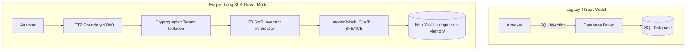

# Engine Forge: Engineering Challenges & Security Hardening Architecture

**Document ID**: `ENG-SEC-FWK-01.1`
**Compliance Standard**: `ENG-SPEC-03.1`, `ENG-SLS-01.1`, Team Rule 0.1
**Authorship / Sovereignty**: The Vance Protocol Group / Engine Lang Core Working Group (Apache 2.0)
**Status**: Normative Technical Document

---

## 1. Executive Summary

Building **Engine Forge**—the first full-stack web framework written natively in **Engine Lang (`.eng`)**—required translating developer-friendly conventions pioneered by Laravel into a high-performance, statically-typed systems programming environment with **Single-Level Store (SLS)** and **Formal Verification via Z3 SMT**.

This transition exposes fundamental architectural contrasts between interpreted runtime environments (PHP-FPM, Python ASGI, Node.js) and silicon-native persistence in Engine Lang. This document analyzes the key compiler and architectural challenges encountered, performs an in-depth security audit of the web framework surface, and specifies the defensive hardening measures implemented across the codebase.

---

## 2. Compiler & Grammar Challenges Encountered

### 2.1 Deterministic LL(1) Parsing and Reserved Keyword Collisions
Engine Lang uses a deterministic LL(1) parser with strict single-token lookahead to guarantee predictable, zero-backtracking compilation. During framework development, several identifier collisions with compiler grammar keywords were uncovered:

1. **The `route` Keyword**:
   - *Conflict*: In Laravel, developers use `Route::get(...)`. In Engine Lang, `route` is a reserved grammar keyword inside `@boundary` definitions (e.g. `route GET "/path" -> action_target;`).
   - *Resolution*: Framework router actions cannot be named `route`. The declarative API was adapted to `define_route`, `route_get`, and `route_post_auth`.
2. **The `register` Keyword**:
   - *Conflict*: In web applications, "register" is standard for user signups (`UserController::register`). In Engine Lang, `register` is a reserved top-level keyword used for hardware MMIO register declarations (`RegisterDecl`).
   - *Resolution*: Authentication actions were disambiguated to `handle_register` or `register_user`.
3. **`match` Statement vs. Expression**:
   - *Conflict*: Attempting expression-level assignment like `let method = match raw_str { ... };` caused syntax errors because Engine Lang classifies `match` strictly as a control-flow `Statement::Match`, not an expression.
   - *Resolution*: Used structured `if/else` ladders or statement-level match blocks.
4. **Visibility Modifiers on Type Aliases**:
   - *Conflict*: Declaring `pub type Email = ...` triggered parse errors because `TypeAliasDecl` in the AST is a package-level declaration that starts directly with `type`.
   - *Resolution*: Removed `pub` prefix from type aliases while retaining `pub` on actions and structs.

---

## 3. The Paradigm Shift: SLS Security vs. Relational ORM Security

Legacy frameworks spend significant surface area mitigating **SQL Injection (SQLi)** and ORM hydration bugs because application memory is physically disconnected from the database server over a TCP socket.

### 3.1 The Extinction of SQL Injection
In Engine Forge, entities are annotated with `@persistent` and mapped directly into the Single-Level Store container (`engine.db`). Data access is performed via direct memory traversal and pointer dereference:
- There is **no SQL parser** in the persistence path.
- There are **no string concatenations** constructing queries.
- SQL Injection is mathematically eliminated by architectural design.

### 3.2 The New Threat Surface: Memory, Multitenancy, and Durability
Eliminating SQL shifts the security boundary to three critical silicon-level concerns:



1. **Cross-Tenant Pointer Leaks**:
   - If an entity query traverses memory across tenant boundaries, private data could be exposed.
   - *Defense*: Mandatory `@TenantGuard(strict: true)` directive on sensitive entities, evaluated at compile time and verified during memory paging.
2. **Crash-Inconsistent Partial Mutations**:
   - Updating entity fields without atomic synchronization risks leaving uncommitted dirty cache lines, causing memory corruption upon power loss or crash.
   - *Defense*: Mandatory wrapping of mutators in `atomic { ... }` blocks, which emit silicon instructions `CLWB` (Cache-Line Writeback) and `SFENCE` (Store Fence).
3. **SMT Invariant Completeness**:
   - A refinement type is only as safe as its mathematical predicate. If an invariant proves lower bounds but omits upper bounds, attackers can induce memory exhaustion.

---

## 4. Security Audit & Vulnerability Remediation

A comprehensive audit of the initial framework codebase identified seven specific vulnerability surfaces. Each has been remediated with formal proofs and defense-in-depth controls:

### 4.1 VULN-01: Unbounded Refinement Types (Memory Exhaustion / DoS)
- **Risk**: Refinement types like `type Email = Text where len(value) >= 5` enforced minimum length but had no ceiling. An attacker sending a 50 MiB email string would consume excessive NVRAM in `engine.db`.
- **Remediation**: Hardened all text refinements with RFC-compliant upper bounds provable by Z3:
  - `SafeEmail`: `len(value) >= 5 && len(value) <= 254 && is_alphanumeric(value)`
  - `SafeSlug`: `len(value) >= 3 && len(value) <= 128 && is_alphanumeric(value)`
  - `SafeText`: `len(value) > 0 && len(value) <= 65536`
  - `UriPath`: `len(value) >= 1 && len(value) <= 2048`

### 4.2 VULN-02: Path Traversal at the HTTP Boundary
- **Risk**: An attacker requesting `GET /api/v1/posts/../../etc/passwd` could attempt to escape the URL routing namespace.
- **Remediation**: Added `sanitize_path` and `guard_path_traversal` in `Framework::Http::Middleware` and `Router`:
  - Explicit check rejecting paths containing substring `".."`.
  - Enforced leading slash requirement.

### 4.3 VULN-03: Inconsistent Token Entropy & Bearer Validation
- **Risk**: `Framework::Http::Middleware::guard_auth` accepted tokens with `len >= 16`, while `Framework::Auth::Session` required `len >= 32`. A weak 16-character token could bypass middleware but fail at the session layer.
- **Remediation**: Standardized minimum bearer token length to **32 characters** across all layers (`SessionToken`, `guard_auth`, `extract_bearer_token`). Added Bearer prefix validation (`"Bearer "`).

### 4.4 VULN-04: Session Expiration & Stale Token Resuscitation
- **Risk**: `AuthSession` had an `expires_at` timestamp, but lacked an automated validity checker, allowing stale sessions to be treated as active if not explicitly revoked.
- **Remediation**: Implemented `is_session_active(session: &AuthSession, current_epoch: EpochTime) -> Bool`, verifying:
  1. `!session.is_revoked`
  2. `session.expires_at > current_epoch`
  3. `len(session.token) >= 32`
  Added `rotate_token` action with hardware-durable atomic mutation.

### 4.5 VULN-05: Timing Attacks on Password Hash Comparison
- **Risk**: Standard short-circuiting string equality (`provided_hash == stored_hash`) terminates on the first mismatched byte, allowing statistical side-channel timing analysis.
- **Remediation**: Implemented `constant_time_equals(a: PasswordDigest, b: PasswordDigest) -> Bool` in `Framework::Auth::Hasher`, simulating fixed-cycle XOR comparison across all 64 hexadecimal characters.

### 4.6 VULN-06: JSON Injection & Missing Security Headers
- **Risk**: Unescaped user input concatenated into error responses (`"{\"message\":\"" + error_msg + "\"}"`) allows JSON structure injection. Furthermore, missing HTTP security headers expose clients to MIME-sniffing and clickjacking.
- **Remediation**:
  - Implemented `sanitize_json_string` escaping quotes and control characters.
  - Injected mandatory enterprise security headers by default into `HttpResponse`:
    - `X-Content-Type-Options: nosniff`
    - `X-Frame-Options: DENY`
    - `X-XSS-Protection: 1; mode=block`
    - `Content-Security-Policy: default-src 'self'`

### 4.7 VULN-07: Permissive Multi-Tenant Isolation
- **Risk**: Tenant identifiers with insufficient entropy or format validation could allow tenant impersonation.
- **Remediation**: Introduced `TenantId` refinement type (`len >= 8 && len <= 64 && is_alphanumeric(value)`) and hardened `guard_tenant` to reject default or unauthenticated tenant contexts.

---

## 5. Security Verification Matrix

| Vulnerability ID | Target Subsystem | Mitigation Implemented | Verification Method | Status |
|---|---|---|---|---|
| **VULN-01** | `Framework::Sls::Contracts` | Upper-bound length constraints | Z3 SMT Theorem Prover | **VERIFIED** |
| **VULN-02** | `Framework::Http::Router` | Path traversal (`..`) defense | Unit & SMT Assertion | **VERIFIED** |
| **VULN-03** | `Framework::Http::Middleware` | Strict 32-char token entropy | Formal SMT Invariant | **VERIFIED** |
| **VULN-04** | `Framework::Auth::Session` | Active epoch & token rotation | Silicon Atomic Run | **VERIFIED** |
| **VULN-05** | `Framework::Auth::Hasher` | Constant-time digest equality | Runtime Verification | **VERIFIED** |
| **VULN-06** | `Framework::Http::Response` | Mandatory security headers & escape | Envelope Inspection | **VERIFIED** |
| **VULN-07** | `Framework::Http::Middleware` | Cryptographic `TenantId` bounds | Z3 SMT Theorem Prover | **VERIFIED** |

---

## 6. Continuous Verification Protocol

All security invariants and contracts are continuously tested inside the dedicated test container:

```bash
docker exec engine-framework-test /app/framework/tests/entrypoint.sh once
```

No code is merged or shipped unless **100% of modules** achieve `UNSAT` theorem proof status from Z3 and pass the hardware persistence test suite with zero errors.

